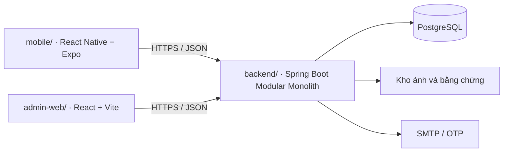

# Kiến trúc mục tiêu và cách kiểm tra

Tại commit nền `4d8216a`, repo chỉ theo dõi `.gitignore` và `LICENSE`. Sơ đồ dưới đây mô tả cấu trúc sẽ dựng trong Phase 0. Khi một module được bàn giao, cập nhật tài liệu này bằng đường dẫn và lệnh chạy đã kiểm chứng từ bản clone mới.

`infra/` chứa cấu hình dịch vụ dùng chung. `docs/` chứa quy trình, kế hoạch, spec và quyết định kỹ thuật. Theo workbook, P0-01 dựng backend Modular Monolith. Nhóm sẽ chọn cách tổ chức bằng Maven multi-module hoặc Java package khi triển khai. Các miền nghiệp vụ trong workbook gồm `iam` (tài khoản và quyền), `catalog` (kho và tin), `chat` (thương lượng), `order` (giữ chỗ và bàn giao), `review` (đánh giá và uy tín), `gov` (kiểm duyệt và quản trị).

## Mốc chốt công nghệ

| Task | Công cụ theo bảng stack | Việc cần ghi nhận khi triển khai |
|---|---|---|
| P0-01 | Temurin JDK 21 LTS, Spring Boot, Maven Wrapper | Chọn Spring Boot 3.5.x hoặc 4.x theo khả năng tương thích của các dependency. Kiểm tra build trước khi khóa phiên bản trong POM. Commit cả wrapper Unix, Windows và `.mvn/wrapper/`. |
| P0-02 | Node 24 LTS, npm, TypeScript, React/Vite, React Native/Expo | Kiểm tra tương thích rồi khóa Expo SDK và commit `package-lock.json` cho từng app. Ghi script dev, test và build trong manifest của app. |
| P0-03 | PostgreSQL, Flyway, Docker Compose | Chọn một major PostgreSQL và dùng cùng major trong Compose và Testcontainers. Tạo migration có phiên bản, kiểm tra cả DB mới và DB từ bản trước. |
| P0-04 | GitHub Actions trên Ubuntu do GitHub cung cấp | Giữ JDK/Node đồng nhất với local. Backend dùng Spotless, JUnit 5, Mockito. Tách integration test REST Assured/Testcontainers. Hai client dùng ESLint và Prettier. Web dùng Vitest + React Testing Library, mobile dùng Jest + React Native Testing Library. |

## Kiểm tra theo phần thay đổi

- **Backend** · Khi P0-01 có wrapper, chạy trong `backend/` lệnh `.\mvnw.cmd clean verify` trên Windows hoặc `./mvnw clean verify` trên Ubuntu. Đối chiếu test với tiêu chí của task. Khi đã cấu hình profile integration test, ghi rõ lệnh kích hoạt và yêu cầu Docker.
- **Mobile và web** · Từ đúng thư mục app có lockfile, chạy `npm ci`, sau đó `npm run` để xem script thật. Chạy lint, test và build tương ứng với nền tảng. Với thay đổi quyền camera hoặc URL kết nối, thử trên giả lập hoặc thiết bị theo tiêu chí task.
- **Hạ tầng và liên ứng dụng** · Tại P0-03, kiểm tra cấu hình Compose, chạy migration và thử cả hai client gọi cùng API. Tại P0-06, lưu kết quả PR mẫu và xác nhận local của 5 thành viên. P4-02 nghiệm thu xuyên ứng dụng bằng Maestro và Playwright.
- **Tài liệu** · Kiểm tra mã task/UC, liên kết tương đối và `git diff --cached --check`. Nếu dự án chưa có manifest hoặc job tương ứng, ghi chính xác phép kiểm tra còn chờ.
