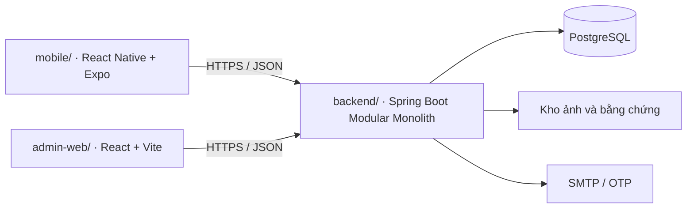

# Kiến trúc mục tiêu và cách kiểm tra

Tại commit nền `4d8216a`, repo chỉ theo dõi `.gitignore` và `LICENSE`. Sơ đồ dưới đây mô tả kiến trúc mục tiêu của Phase 0. Khi một module được bàn giao, cập nhật tài liệu này bằng đường dẫn và lệnh chạy đã kiểm chứng từ bản clone mới.



P0-02 tạo `mobile/` và `admin-web/`. P0-03 tạo `infra/` cho cấu hình dịch vụ dùng chung. `docs/` chứa quy trình, kế hoạch, spec và quyết định kỹ thuật. Theo workbook, P0-01 dựng backend Modular Monolith. Backend dùng một Maven module, tổ chức mã theo [quyết định P0-01](decisions/P0-01-khung-backend.md). Các miền nghiệp vụ trong workbook gồm `iam` (tài khoản và quyền), `catalog` (kho và tin), `chat` (thương lượng), `order` (giữ chỗ và bàn giao), `review` (đánh giá và uy tín), `gov` (kiểm duyệt và quản trị).

## Mốc chốt công nghệ

| Task | Công cụ theo bảng stack | Việc cần ghi nhận khi triển khai |
|---|---|---|
| P0-01 | Temurin JDK 21 LTS, Spring Boot, Maven Wrapper | Spring Boot 3.5.14 và Maven 3.9.16. Xem [POM](../backend/pom.xml) và [cấu hình wrapper](../backend/.mvn/wrapper/maven-wrapper.properties). |
| P0-02 | Node 24 LTS, npm, TypeScript, React/Vite, React Native/Expo | Đã chốt: `mobile/` dùng Expo SDK 53, React Native 0.79.5, React 19.0.0, TypeScript 5.8.3; `admin-web/` dùng React 18.3.1, Vite 6.3.5, React Router 6.30.1, Vitest. Hai app giữ `package-lock.json` kiểu 3 và script `start`/`dev`, `lint` (`tsc --noEmit`), `test`, `build`. Xem [spec P0-02](specs/P0-02.md). |
| P0-03 | PostgreSQL, Flyway, Docker Compose | PostgreSQL 16 trong Compose và Testcontainers. Giữ V1/V2, migration tiếp theo dùng V3/V4… do đầu mối điều phối; kiểm tra DB mới và nâng từ bản trước. |
| P0-04 / P0-06 | GitHub Actions trên Ubuntu do GitHub cung cấp | CI nền P0-04 được P0-06 mở rộng: `repository`, `workflow-lint`, `backend` (Temurin 21, clean verify hiện có 7 test, Surefire artifact), `admin-web` và `mobile` (Node 24, lint/test/build hoặc export Android). `required` gom đủ năm job và xuất Step Summary. Xem [spec P0-06](specs/P0-06.md) và [quyết định](decisions/P0-06-quy-uoc-va-ci.md). |

## Kiểm tra theo phần thay đổi

- **Backend** · Chạy trong `backend/` lệnh `.\mvnw.cmd clean verify` trên Windows hoặc `./mvnw clean verify` trên Ubuntu. Đối chiếu test với tiêu chí của task. Khi đã cấu hình profile integration test, ghi rõ lệnh kích hoạt và yêu cầu Docker.
- **Mobile và web** · Từ đúng thư mục app có lockfile, chạy `npm ci`, sau đó `npm run` để xem script thật. Chạy lint, test và build tương ứng với nền tảng. Với thay đổi quyền camera hoặc URL kết nối, thử trên giả lập hoặc thiết bị theo tiêu chí task.
- **Hạ tầng và liên ứng dụng** · Tại P0-03, kiểm tra cấu hình Compose, chạy migration và thử cả hai client gọi cùng API. Tại P0-06, dùng [checklist](conventions/P0-06-checklist.md), lưu kết quả PR mẫu và xác nhận local của 5 thành viên. P4-02 nghiệm thu xuyên ứng dụng bằng Maestro và Playwright.
- **Tài liệu** · Kiểm tra mã task/UC, liên kết tương đối và `git diff --cached --check`. Nếu dự án chưa có manifest hoặc job tương ứng, ghi chính xác phép kiểm tra còn chờ.

## Chạy backend P0-01

Trỏ `JAVA_HOME` đến Temurin JDK 21. Trong [backend/](../backend/), chạy Maven Wrapper theo mục kiểm tra ở trên. Lần đầu cần kết nối Internet để tải Maven và dependency. Bộ test tự cung cấp khóa, khởi động server trên cổng ngẫu nhiên và gọi HTTP. Có thể chạy khi chưa có DB hoặc Docker.

Để chạy ứng dụng trên Windows, tạo khóa thử riêng cho phiên PowerShell rồi khởi động từ thư mục backend.

```powershell
$key = New-Object byte[] 32
$rng = [System.Security.Cryptography.RandomNumberGenerator]::Create()
$rng.GetBytes($key)
$rng.Dispose()
$env:JWT_SECRET = [Convert]::ToBase64String($key)
.\mvnw.cmd spring-boot:run
```

Trên Ubuntu, dùng `export JWT_SECRET="$(openssl rand -base64 32)"` rồi chạy `./mvnw spring-boot:run`. Mở [health trên máy local](http://localhost:8082/api/v1/health). API trả HTTP 200 và JSON gồm `status` bằng `UP`, `service` bằng `dorm-trading-backend` và `timestamp`. Dùng `SERVER_PORT` để đổi cổng. Web Vite ở origin `http://localhost:5173` được phép gọi API. Đặt `CORS_ALLOWED_ORIGINS` thành danh sách origin phân tách bằng dấu phẩy khi chạy web ở địa chỉ khác. Client di động dùng địa chỉ backend mà thiết bị truy cập được, ví dụ `http://10.0.2.2:8082` trên Android Emulator.


## Hiện trạng xác thực P1-01 · 13/11/2026

Backend có auth API chung cho mobile/web, PostgreSQL session/challenge/outbox ở V3/V4; JWT không còn khóa fallback. Xem [hợp đồng và kiểm chứng](specs/P1-01.md), [quyết định](decisions/P1-01-hop-dong-xac-thuc.md). ApiSecurityTest nay dùng PostgreSQL Testcontainers vì kiểm quyền phải đọc phiên thật; hướng dẫn P0-01 chạy test không DB ở trên là lịch sử nền.

Mobile lưu access/refresh trong SecureStore; web access trong bộ nhớ và refresh cookie HttpOnly/Secure/SameSite=Strict. Môi trường triển khai cần HTTPS và web/API cùng site; localhost là môi trường thử, không giảm Secure cho production. CORS chỉ cho origin cụ thể, credentials=true và expose WWW-Authenticate. Health chuẩn /api/v1/health. SMTP OTP gửi qua outbox mã hóa, có retry trong hạn mã; không in OTP/token/mật khẩu vào log.

Vai trò MEMBER/MODERATOR/SENIOR_ADMIN, scope client và trạng thái tài khoản kiểm tại API. Các API quản trị mới dùng /admin/** hoặc /admin/senior/** đúng quyền; prefix này thay quy tắc ADMIN nền. Điểm100 và kích hoạt hồ sơ còn do P1-02; quyền tài khoản khóa chi tiết còn P1-05.
