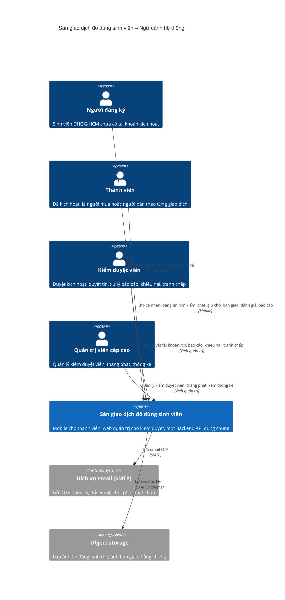

# C4 mức 1 – Ngữ cảnh hệ thống

Hệ thống nhìn như một hộp đen, cùng các tác nhân và hệ thống ngoài. Nguồn tác nhân: danh sách Actor trong mô hình use case (UC-01..UC-40).

Ghi chú:

- Người mua và người bán không phải hai loại tài khoản; cùng một Thành viên đóng vai trò khác nhau theo từng giao dịch.
- Scheduler (nhắc giữ chỗ, quá hạn 24h, +1 sau 15 ngày, nhắc gia hạn tin) nằm bên trong hệ thống, thể hiện ở mức container.
- Không tích hợp SSO của trường và không có cổng thanh toán; thanh toán diễn ra trực tiếp ngoài ứng dụng.
