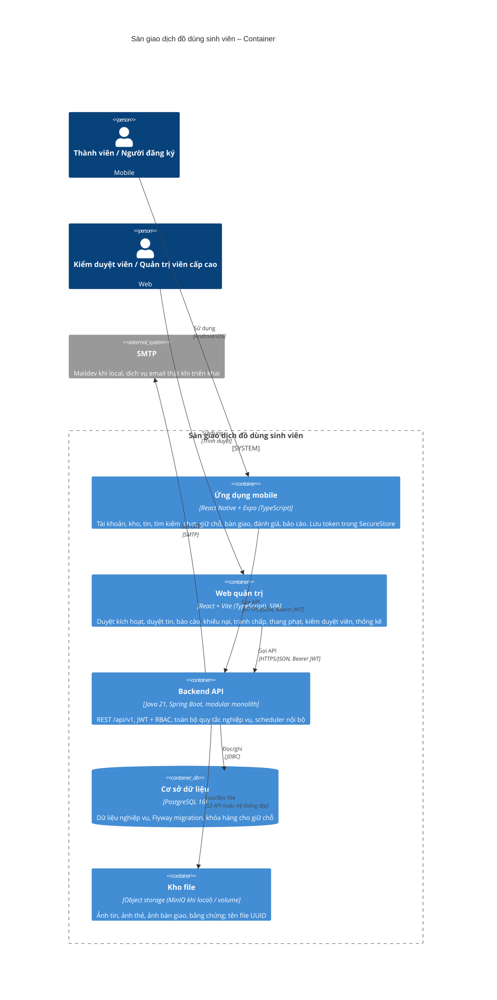

# C4 mức 2 – Container

Các đơn vị triển khai bên trong hệ thống và cách chúng giao tiếp.

## Nguyên tắc

| Nguyên tắc | Hệ quả |
| --- | --- |
| Một API cho hai client | Không nhân đôi nghiệp vụ; OpenAPI là hợp đồng chung; thay đổi hợp đồng phải báo cả người làm mobile lẫn web ([ADR-002](../adr/ADR-002-shared-backend-api-for-mobile-and-admin-web.md)) |
| Client không chứa quy tắc nghiệp vụ | Mobile/web chỉ hiển thị và kiểm tra hình thức đầu vào; API trả lỗi có mã để client dịch sang thông điệp |
| Scheduler nằm trong Backend API | Dùng Spring scheduling với khóa DB (`SELECT ... FOR UPDATE SKIP LOCKED`) để chạy an toàn khi có nhiều bản sao; không cần dịch vụ job riêng |
| File hạn chế đi qua API | Ảnh thẻ, ảnh bàn giao, bằng chứng chỉ đọc qua endpoint kiểm quyền theo hồ sơ/giao dịch/báo cáo; ảnh tin công khai có thể phục vụ trực tiếp |
| Không WebSocket ở giai đoạn này | Chat và thông báo dùng polling có khoảng nghỉ; xem xét lại khi đo được nhu cầu |

## Triển khai

Local: Docker Compose chạy PostgreSQL, Maildev, MinIO (P0-03). Backend chạy từ Maven, web quản trị từ Vite, mobile từ Expo trỏ về API qua địa chỉ LAN. Staging/Prod: image backend và web quản trị trên GHCR, Compose + Nginx/Traefik trên một VPS (P4-01). Chi tiết mobile tại [quy trình đóng gói và phân phối](../mobile-build-and-distribution.md).
