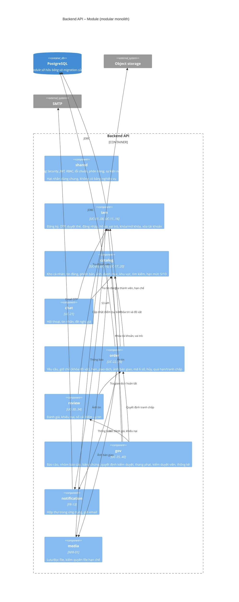

# C4 mức 3 – Module bên trong Backend API

Các component là module logic mục tiêu trong **một Maven module**, gốc package `com.dormtrading` theo [quyết định P0-06](../../decisions/P0-06-quy-uoc-va-ci.md). Hiện có sáu package miền và `common`; `shared`, `notification`, `media` là mục tiêu tổ chức, chưa phải package/module đã tạo. Mũi tên là phụ thuộc nghiệp vụ cho phép, không khẳng định các luồng đã triển khai.



## Cấu trúc bên trong một module

```text
backend/src/main/java/com/dormtrading/<mien>/
├── api/            REST controller + DTO request/response (chỉ lớp này được expose ra HTTP)
├── application/    Application service: giao dịch, kiểm quyền, điều phối; API công khai cho module khác
├── domain/         Entity, value object, quy tắc nghiệp vụ, domain event
└── infrastructure/ JPA repository, adapter SMTP/storage, scheduler
backend/src/main/resources/db/migration/   Flyway V1/V2; tiếp theo V3__<mo_ta>.sql
backend/src/test/java/com/dormtrading/      Unit test + integration test Testcontainers
```

Các tầng trong cây trên là quy ước cho nghiệp vụ mới, không phải tất cả package đã có ở scaffold. Ranh giới cần review: gói `api` không được tham chiếu từ miền khác; chỉ service/DTO công khai được gọi chéo miền. ArchUnit là hướng mở rộng chưa triển khai; CI P0-06 chưa kiểm tra tự động ranh giới này.

## Giao dịch và khóa quan trọng

| Nghiệp vụ | Module chủ | Bất biến phải giữ | Cách giữ |
| --- | --- | --- | --- |
| Chấp nhận giữ chỗ (UC-23) | `order` | Một đồ vật có tối đa một giữ chỗ hiệu lực trên mọi tin; combo giữ hết hoặc không | Khóa hàng đồ vật theo thứ tự id tăng dần trong một giao dịch DB; kiểm lại phiên bản tin |
| Hoàn tất bằng mã (UC-27) | `order` | Nhập đúng mã chỉ hoàn tất một lần; tối đa 5 lần sai, hết hạn 10 phút | Mã lưu dạng băm, cập nhật trạng thái có điều kiện (idempotent) |
| Áp dụng điểm (UC-30, UC-34, UC-37) | `review` | Mỗi nguồn sinh tối đa một khoản | Khóa duy nhất trên (nguồn, mã nguồn) của `reputation_entry` |
| Đăng tin / hạn mức (UC-10) | `catalog` | Không vượt 5 hoặc 10 tin mở + giữ | Đếm trong cùng giao dịch dưới khóa hàng thành viên |
