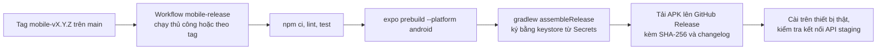

# Quy trình đóng gói và phân phối bản mobile

Trạng thái: khởi tạo Phase 0 (P0-05), đồng bộ P0-06 ngày 08/11/2026. P0-02 đã chốt Expo SDK 53; tài khoản ký và đóng gói phát hành thuộc P4-01. Các mục đánh dấu **[chờ chốt]** chưa phải quyết định.

## 1. Mục tiêu

- Mọi thành viên chạy được app trên giả lập hoặc thiết bị thật kết nối backend local (P0-06).
- CI kiểm tra được app không gãy ở mỗi PR mà không cần ký.
- Có bản cài Android nội bộ cho nghiệm thu và bảo vệ đồ án, không cần đưa lên cửa hàng.

## 2. Ba loại bản

| Loại | Dùng khi | Cách tạo | Ký |
| --- | --- | --- | --- |
| Phát triển (Expo Go hoặc development build) | Hằng ngày, Phase 0–3 | `npx expo start`, quét QR hoặc mở trên giả lập | Không |
| Kiểm tra CI | Mỗi PR | Node 24, `npm ci`, `npm run lint`, `npm test`, `npm run build` (export Android). Chưa chạy prebuild/Gradle; bundle đạt chưa chứng minh cấu hình native hoặc UI trên thiết bị | Không |
| Phát hành nội bộ (APK) | Nghiệm thu, demo, Phase 4 | Workflow thủ công `mobile-release` trên GitHub Actions: `expo prebuild` rồi `./gradlew assembleRelease`, hoặc EAS Build hồ sơ `preview` **[chờ chốt: local Gradle hay EAS]** | Keystore của nhóm |

iOS: chỉ chạy trên giả lập và Expo Go; không làm bản cài iOS vì cần tài khoản Apple Developer trả phí **[chờ chốt nếu nhóm có tài khoản]**.

## 3. Cấu hình môi trường API

App đọc địa chỉ backend từ biến `EXPO_PUBLIC_API_URL` (Expo chỉ nhúng biến có tiền tố `EXPO_PUBLIC_`). Không hard-code địa chỉ trong mã.

| Môi trường | Giá trị | Ghi chú |
| --- | --- | --- |
| Giả lập Android chuẩn | `http://10.0.2.2:8082/api/v1` | Địa chỉ máy chủ nhìn từ Android Emulator; LDPlayer dùng IP LAN |
| Giả lập iOS | `http://localhost:8082/api/v1` | Chạy trên máy hỗ trợ iOS Simulator |
| Thiết bị thật / LDPlayer | `http://<IP LAN máy dev>:8082/api/v1` | Cùng mạng; kiểm tra đường mạng và cổng backend trước khi mở app |
| Staging / Prod | `https://api.<domain>/api/v1` | Bắt buộc HTTPS; cấu hình trong hồ sơ phát hành |

File `mobile/.env.example` liệt kê biến; `.env` không commit. Với thiết bị thật, P0-03 cung cấp hướng dẫn mở cổng/firewall.

## 4. Phiên bản và đặt tên

- `version` trong `app.json` theo SemVer, trùng tag Git `mobile-v<version>`.
- `android.versionCode` tăng tự động bằng số lần chạy workflow (`github.run_number`), không sửa tay.
- Tên file bản cài: `dorm-trading-<version>-<versionCode>.apk`.

## 5. Ký và bí mật

- Keystore Android do một người tạo một lần, lưu dưới dạng base64 trong GitHub Secrets (`ANDROID_KEYSTORE_BASE64`, `ANDROID_KEYSTORE_PASSWORD`, `ANDROID_KEY_ALIAS`, `ANDROID_KEY_PASSWORD`). Không commit keystore hay mật khẩu; mất keystore là không cập nhật được app đã cài, nên lưu bản sao ngoài GitHub cho trưởng nhóm.
- App không chứa secret nào khác: không khóa API, không chuỗi kết nối. Token người dùng lưu bằng Expo SecureStore ([ADR-003](adr/ADR-003-jwt-rbac-role-boundaries.md)). P4-04 kiểm tra lại bằng cách giải nén APK và tìm chuỗi nhạy cảm.

## 6. Luồng phát hành nội bộ

Điều kiện phát hành: CI xanh trên `main`, bản APK cài được trên ít nhất hai thiết bị thật của nhóm và chạy được luồng đăng nhập + tìm kiếm với API staging.

## 7. Phân phối và cài đặt

- Tải APK từ trang Release của repo; kiểm tra SHA-256 trước khi cài.
- Android yêu cầu bật cài từ nguồn không xác định cho trình duyệt hoặc ứng dụng tệp.
- Cập nhật bản mới: cài đè, cùng chữ ký nên giữ dữ liệu; không dùng OTA update của Expo trong phạm vi đồ án để tránh lệch bản demo.

## 8. Liên quan

- [Kiến trúc tổng thể](README.md), [C4 mức 2](c4/c4-level2-container.md)
- Nhiệm vụ: P0-02 khởi tạo app và chốt SDK; P0-03 cấu hình API URL cho giả lập/thiết bị thật; P0-04 job CI mobile; P4-01 đóng gói phát hành; P4-04 kiểm tra bảo mật mobile.
