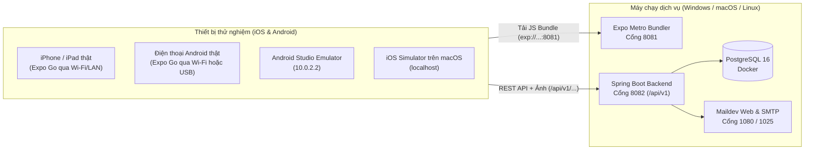

# Hướng dẫn trải nghiệm ứng dụng di động trên iOS và Android

Tài liệu này hướng dẫn các thành viên Nhóm 14 khởi chạy và trải nghiệm trực tiếp ứng dụng di động `mobile/` (**Expo SDK 58** · React Native `0.88.1` · React `19.3`) kết nối với Backend API thật trên cả **iOS** và **Android** (thiết bị thật lẫn máy giả lập).

Liên quan: [Quy trình đóng gói và phân phối mobile](architecture/mobile-build-and-distribution.md) · [Quyết định nâng cấp Expo SDK 58](decisions/P2-mobile-expo-sdk-58.md) · [Kiến trúc hệ thống](01-architecture.md).

---

## 1. Kiến trúc kết nối khi chạy thử



> **Cơ chế tự động đồng bộ ảnh sản phẩm (`resolveMediaUrl`):** App di động tự động ánh xạ các đường dẫn `/api/v1/media/{id}` từ địa chỉ nội bộ (`localhost`, `127.0.0.1`, `10.0.2.2`, IP LAN) sang đúng gốc `EXPO_PUBLIC_API_URL` của từng máy khách. Nhờ đó, nhiều thành viên dùng iPhone thật, điện thoại Android thật và Android Emulator có thể truy cập **cùng một Backend** mà ảnh sản phẩm vẫn hiển thị đầy đủ trên mọi thiết bị.

---

## 2. Hai mô hình thử nghiệm cho nhóm

| Mô hình | Khi nào dùng | Cách vận hành |
| --- | --- | --- |
| **A. Dùng chung 1 máy Host qua Wi-Fi / Hotspot** *(Khuyên dùng khi họp nhóm / demo chéo)* | Các thành viên ngồi chung phòng/KTX hoặc bắt chung Hotspot điện thoại, muốn test nhiều vai trò tương tác thời gian thực trên cùng dữ liệu. | **Chỉ 1 thành viên** bật Docker + Backend (`8082`) + `npx expo login` + Expo LAN (`8081`). Các thành viên còn lại cài **Expo Go**, bắt chung Wi-Fi và quét mã QR *(riêng iPhone cần đăng nhập chung tài khoản Expo của máy Host hoặc thuộc cùng một Expo Organization miễn phí)*. |
| **B. Mỗi thành viên tự chạy độc lập tại nhà** | Làm việc/kiểm thử cá nhân trên máy riêng. | Mỗi thành viên tự bật Docker + Backend + `npx expo login` + Expo trên máy của mình, rồi đăng nhập cùng tài khoản Expo đó trên **Expo Go** ở điện thoại cá nhân hoặc dùng máy giả lập. |

---

## 3. Bốn lưu ý quan trọng trước khi gõ lệnh

1. **Luôn đứng trong thư mục `mobile/` khi chạy lệnh Expo / npm:**
   - Đây là monorepo (`backend/`, `mobile/`, `admin-web/`), thư mục gốc **không có** `package.json`.
   - Nếu chạy `npx expo start` ngay tại thư mục gốc `dorm-trading-platform`, `npx` sẽ tải nhầm gói `expo` từ registry và báo lỗi:
     `ConfigError: The expected package.json path: ...\dorm-trading-platform\package.json does not exist`.
   - Luôn chạy `cd mobile` trước tiên.
2. **Bắt buộc đăng nhập đồng bộ tài khoản Expo trên cả CLI (`npx expo login`) và app Expo Go:**
   - Từ Expo SDK mới (đặc biệt trên **iOS Expo Go**), Expo yêu cầu xác thực chủ sở hữu phiên phát triển trước khi cho phép mở dự án trên thiết bị thật.
   - Tạo tài khoản miễn phí tại [expo.dev/signup](https://expo.dev/signup) (nếu chưa có), đứng trong `mobile/` và đăng nhập CLI một lần:
     ```bash
     cd mobile
     npx expo login      # Windows PowerShell nếu bị chặn npx.ps1: cmd /c npx expo login
     npx expo whoami     # Kiểm tra tên tài khoản đang đăng nhập
     ```
   - Mở ứng dụng **Expo Go** trên iPhone / Android → nhấn biểu tượng hồ sơ góc trên bên phải → **Sign In** bằng **đúng tài khoản Expo** vừa đăng nhập trên CLI.
   - *Mẹo khi cả nhóm 5 người cùng quét 1 máy Host trên iPhone:* dùng chung 1 tài khoản Expo dev của nhóm trên Expo Go khi họp demo, hoặc tạo một **Expo Organization** miễn phí trên [expo.dev](https://expo.dev) và mời các thành viên vào chung Organization.
3. **Trên Windows PowerShell bị chặn script (`npx.ps1` / `npm.ps1`):**
   - Nếu gặp lỗi `cannot be loaded because running scripts is disabled on this system`, hãy dùng `npm.cmd` / `cmd /c npx ...`, hoặc mở quyền một lần cho user hiện tại:
     ```powershell
     Set-ExecutionPolicy -Scope CurrentUser -ExecutionPolicy RemoteSigned
     ```
4. **Trên Windows có cài WSL2 / Docker Desktop / Hyper-V (`vEthernet`):**
   - Máy Windows thường có nhiều card mạng ảo (`172.22.x.1`, `172.29.x.1`). Nếu không chỉ định rõ, `expo start --host lan` có thể lấy nhầm IP ảo khiến điện thoại quét QR bị treo kết nối.
   - Hãy gán `REACT_NATIVE_PACKAGER_HOSTNAME=<IP_LAN_THẬT>` trước khi chạy Expo (xem chi tiết ở Mục 6).

---

## 4. Bước 1 — Khởi động Hạ tầng & Backend (trên máy Host)

### 4.1 Bật PostgreSQL và Maildev bằng Docker
Đứng tại **thư mục gốc** của repo:

```bash
docker compose up -d postgres maildev
```

- Kiểm tra nhanh trạng thái container: `docker compose ps` (`dorm-postgres` và `dorm-maildev` ở trạng thái `healthy`).
- Hộp thư giả lập nhận mã OTP (đăng ký / quên mật khẩu): mở trình duyệt tại `http://localhost:1080`.
- Lưu ý: nếu máy bạn đổi cổng host của PostgreSQL trong `.env` gốc (ví dụ `POSTGRES_PORT=15432` để tránh đụng PostgreSQL cài sẵn trên máy), hãy truyền cùng giá trị `POSTGRES_PORT` cho Backend ở bước dưới.

### 4.2 Khởi động Spring Boot Backend (cổng `8082`)
Backend yêu cầu biến `JWT_SECRET` (chuỗi Base64 dài tối thiểu 32 byte sau giải mã).

**Trên Windows (PowerShell):**
```powershell
cd backend
$env:JWT_SECRET = [Convert]::ToBase64String((1..32 | ForEach-Object { Get-Random -Maximum 256 }))
# Nếu PostgreSQL Docker map sang cổng khác 5432 (ví dụ 15432), mở dòng dưới:
# $env:POSTGRES_PORT = "15432"
.\mvnw.cmd spring-boot:run
```

**Trên macOS / Linux:**
```bash
cd backend
export JWT_SECRET="$(openssl rand -base64 32)"
./mvnw spring-boot:run
```

### 4.3 Tìm địa chỉ IP LAN của máy Host & kiểm tra thông cổng `8082`
Tìm địa chỉ IPv4 của card Wi-Fi hoặc Ethernet thật (thường có dạng `192.168.x.x` hoặc `10.x.x.x`, **không** lấy `172.16–31.x.1` của `vEthernet`/WSL/Docker):

- **Windows (PowerShell):**
  ```powershell
  Get-NetIPAddress -AddressFamily IPv4 | Where-Object { $_.InterfaceAlias -notmatch 'vEthernet|Loopback' } | Select-Object InterfaceAlias, IPAddress
  ```
- **macOS:** `ipconfig getifaddr en0`
- **Linux:** `hostname -I`

Kiểm tra nhanh từ máy Host:
```bash
curl http://<IP_LAN>:8082/api/v1/health
```
Phản hồi mong đợi: `{"status":"UP","service":"dorm-trading-backend",...,"database":"CONNECTED"}`.

> **Kiểm tra từ điện thoại thật:** Mở trình duyệt Safari (iOS) hoặc Chrome (Android) trên điện thoại (đang bắt cùng Wi-Fi với máy Host) và truy cập `http://<IP_LAN>:8082/api/v1/health`. Nếu thấy JSON `"status":"UP"`, đường mạng giữa điện thoại và Backend đã thông hoàn toàn. Nếu không vào được, xem ngay [Mục 8 — Xử lý sự cố](#8-xử-lý-sự-cố-thường-gặp).

---

## 5. Bước 2 — Cấu hình `mobile/.env` theo thiết bị cần test

Mở thư mục `mobile/`, tạo file `.env` từ mẫu nếu chưa có:

```bash
cd mobile
npm ci
cp .env.example .env   # PowerShell: Copy-Item .env.example .env
```

Chỉnh dòng `EXPO_PUBLIC_API_URL` trong `mobile/.env` theo đúng loại thiết bị bạn dùng:

| Thiết bị thử nghiệm | Hệ điều hành máy dev | Giá trị `EXPO_PUBLIC_API_URL` trong `mobile/.env` | Giải thích |
| --- | --- | --- | --- |
| **iPhone / iPad thật** (Expo Go qua Wi-Fi) | Windows / macOS / Linux | `http://<IP_LAN>:8082/api/v1` | Điện thoại gọi sang máy Host qua mạng nội bộ (ví dụ `http://192.168.1.15:8082/api/v1`). Không dùng `localhost`/`127.0.0.1`. |
| **Điện thoại Android thật** (Expo Go qua Wi-Fi) | Windows / macOS / Linux | `http://<IP_LAN>:8082/api/v1` | Giống iPhone thật khi bắt chung mạng nội bộ. |
| **Điện thoại Android thật cắm cáp USB** (`adb reverse`) | Windows / macOS / Linux | `http://127.0.0.1:8082/api/v1` | Dùng khi Wi-Fi trường/KTX bật *AP Isolation* chặn các máy nhìn thấy nhau qua LAN (xem Mục 6.2). |
| **Android Studio Emulator** | Windows / macOS / Linux | `http://10.0.2.2:8082/api/v1` | `10.0.2.2` là alias đặc biệt của Android Emulator trỏ về `localhost` của máy Host. |
| **LDPlayer / BlueStacks** | Windows | `http://<IP_LAN>:8082/api/v1` | Giả lập bên thứ ba thường dùng card cầu nối LAN thay vì `10.0.2.2`. |
| **iOS Simulator** (Xcode) | Chỉ macOS | `http://localhost:8082/api/v1` | iOS Simulator chia sẻ trực tiếp network stack với macOS. |

> **Lưu ý:** Mỗi lần sửa `mobile/.env`, cần khởi động lại Expo kèm cờ `--clear` (hoặc `npm run start:lan`) để Metro nhúng lại biến `EXPO_PUBLIC_API_URL` mới vào bundle.

---

## 6. Bước 3 — Mở ứng dụng trên iOS và Android

### 6.1 Trải nghiệm trên iOS

#### Cách 1: Trên iPhone / iPad thật (Dùng được trên cả Windows, macOS, Linux)
1. Mở **App Store** trên iPhone / iPad, tìm và cài đặt **Expo Go**, sau đó mở **Expo Go** và **Sign In** vào tài khoản Expo của bạn (hoặc tài khoản Expo dùng chung của nhóm).
2. Kết nối iPhone vào **cùng mạng Wi-Fi / LAN** với máy chạy Backend + Expo (hoặc bật Hotspot 4G/5G từ điện thoại rồi cho laptop kết nối vào Hotspot đó nếu Wi-Fi công cộng chặn LAN).
3. Trên máy tính, vào thư mục `mobile/`, đăng nhập CLI bằng đúng tài khoản trên rồi bật Expo ở chế độ LAN:
   - **Windows PowerShell:**
     ```powershell
     cd mobile
     cmd /c npx expo login                                # Chạy 1 lần nếu chưa đăng nhập (kiểm tra: cmd /c npx expo whoami)
     $env:REACT_NATIVE_PACKAGER_HOSTNAME = "<IP_LAN>"     # Ví dụ: "192.168.100.181"
     npm.cmd run start:lan
     ```
   - **macOS / Linux:**
     ```bash
     cd mobile
     npx expo login                                       # Chạy 1 lần nếu chưa đăng nhập (kiểm tra: npx expo whoami)
     REACT_NATIVE_PACKAGER_HOSTNAME="<IP_LAN>" npm run start:lan
     ```
4. Mở ứng dụng **Camera** mặc định của iPhone, hướng vào mã QR trên terminal → chạm vào thông báo màu vàng **"Open in Expo Go"** (hoặc gõ thẳng `exp://<IP_LAN>:8081` vào thanh địa chỉ **Safari**).
5. Khi iOS hiện hộp thoại hỏi quyền *"Expo Go would like to find and connect to devices on your local network"*, chọn **Allow (Cho phép)**.

#### Cách 2: Trên iOS Simulator (Chỉ dành cho thành viên dùng macOS có cài Xcode)
1. Đặt `EXPO_PUBLIC_API_URL=http://localhost:8082/api/v1` trong `mobile/.env`.
2. Chạy:
   ```bash
   cd mobile
   npm run ios
   ```
   *(Hoặc chạy `npm start` rồi nhấn phím `i` trong cửa sổ terminal của Expo).*

---

### 6.2 Trải nghiệm trên Android

#### Cách 1: Trên điện thoại Android thật qua Wi-Fi / LAN (Không cần cáp)
1. Cài đặt hoặc cập nhật **Expo Go** mới nhất từ **Google Play Store** (hỗ trợ **Expo SDK 58**; nếu Play Store không khả dụng trên máy, tải APK Expo Go tương ứng SDK 58 tại [expo.dev/go](https://expo.dev/go)).
2. Đặt `EXPO_PUBLIC_API_URL=http://<IP_LAN>:8082/api/v1` trong `mobile/.env`.
3. Khởi động Expo LAN giống Mục 6.1 (`npm run start:lan` hoặc `npm.cmd run start:lan` kèm `REACT_NATIVE_PACKAGER_HOSTNAME`).
4. Mở ứng dụng **Expo Go** trên Android → chạm **Scan QR code** để quét mã QR trên terminal (hoặc chọn *Enter URL manually* và nhập `exp://<IP_LAN>:8081`).

#### Cách 2: Trên điện thoại Android thật qua cáp USB (Bất chấp Wi-Fi KTX chặn LAN)
Nếu Wi-Fi KTX/trường học chặn giao tiếp nội bộ giữa các thiết bị:
1. Bật **USB Debugging (Gỡ lỗi USB)** trên điện thoại Android và cắm cáp vào máy tính.
2. Đặt `EXPO_PUBLIC_API_URL=http://127.0.0.1:8082/api/v1` trong `mobile/.env`.
3. Ánh xạ cả cổng Metro (`8081`) và cổng Backend (`8082`) qua cáp USB:
   ```bash
   adb devices
   adb reverse tcp:8081 tcp:8081
   adb reverse tcp:8082 tcp:8082
   ```
4. Chạy `cd mobile && npx expo start --localhost --clear`, sau đó mở **Expo Go** trên điện thoại và nhập URL `exp://127.0.0.1:8081` (hoặc nhấn phím `a` trên terminal).

#### Cách 3: Trên Android Studio Emulator
1. Mở sẵn một thiết bị ảo (AVD) trong Android Studio Device Manager.
2. Đặt `EXPO_PUBLIC_API_URL=http://10.0.2.2:8082/api/v1` trong `mobile/.env`.
3. Kiểm tra giả lập nhìn thấy Backend:
   ```bash
   adb shell "curl -s http://10.0.2.2:8082/api/v1/health"
   ```
4. Khởi chạy ứng dụng lên giả lập:
   ```bash
   cd mobile
   npm run android
   ```
   *(Hoặc chạy `npm start -- --clear` rồi nhấn phím `a`).*

---

## 7. Kịch bản trải nghiệm các chức năng hiện có

Sau khi ứng dụng mở lên trên iOS hoặc Android, các thành viên có thể kiểm thử theo trình tự sau:

### 7.1 Nhóm luồng Khách vãng lai — Khám phá & Tìm kiếm (`P2-02` · `UC-19`, `UC-20`)
Không cần đăng nhập vẫn trải nghiệm được ngay:
1. **Lướt bảng tin công khai:** Chuyển đổi chế độ xem Lưới / Danh sách, kéo để làm mới (Pull-to-refresh), cuộn tải trang tiếp theo.
2. **Tìm kiếm & Bộ lọc kết hợp:**
   - Gõ từ khóa tên đồ vật hoặc mã môn học (ví dụ `SE100`, `IT001`, `Casio`, `Bàn phím`).
   - Lọc theo cây danh mục phân cấp (chọn danh mục cha `GIAO_TRINH` sẽ tự lấy cả các danh mục con), khoảng giá `minPrice`–`maxPrice`, nút **Miễn phí (0đ)** hoặc loại tin **Combo**.
   - Bật lọc khu vực ĐHQG-HCM (`KTX Khu A`, `KTX Khu B`, `ĐH CNTT`, ...) và sắp xếp **Gần nhất** (`distance_asc`) hoặc theo giá.
3. **Xem chi tiết tin đăng (PDP):** Chạm vào một tin để xem bộ ảnh thực tế (chạm vào ảnh để mở **Lightbox toàn màn hình** vuốt ngang), danh sách món đồ thành phần của combo, điểm uy tín & đánh giá sao của người bán.

### 7.2 Nhóm luồng Tài khoản & Xác thực (`P1-01` · `UC-01`, `UC-03`, `UC-04`, `UC-07`, `UC-08`)
- **Cách A — Đăng ký tài khoản mới:**
  1. Vào mục **Tài khoản / Đăng nhập** → chuyển sang **Đăng ký**.
  2. Nhập họ tên, MSSV, email đuôi `.edu.vn` (ví dụ `tenban@gm.uit.edu.vn`) và mật khẩu dài **15–128 ký tự** (không nằm trong danh sách mật khẩu phổ biến/đã lộ).
  3. Mở giao diện Maildev tại `http://<IP_LAN_HOAC_LOCALHOST>:1080` để lấy **mã OTP 6 số** (hiệu lực 5 phút) và xác minh email.
  4. *Lưu ý:* Theo quy tắc nghiệp vụ `FR-01` (`P1-01` / `P1-02`), tài khoản mới xác minh email sẽ ở trạng thái chờ duyệt hồ sơ (`CHO_KICH_HOAT` — vẫn xem được tin công khai và sửa họ tên trong Hồ sơ, nhưng chưa có `ROLE_MEMBER` để đăng tin/quản lý kho). Khi chưa ghép màn duyệt `P1-02`, để cấp quyền thành viên ngay trên môi trường dev local phục vụ test Phase 2, chạy lệnh SQL sau trên máy Host:
     ```bash
     docker exec dorm-postgres psql -U dorm_user -d dorm_trading -c "UPDATE thanh_viens SET email_verified = TRUE, profile_approved = TRUE, trang_thai_tai_khoan = 'HOAT_DONG', diem_uy_tin = 100 WHERE email = 'tenban@gm.uit.edu.vn';"
     ```
     Sau đó đăng xuất và đăng nhập lại trên điện thoại để nhận phiên có `ROLE_MEMBER`.
- **Cách B — Dùng dữ liệu demo có sẵn (nếu máy Host đã chạy seed demo):**
  - Nếu máy Host đã nạp dữ liệu demo qua `.local/seed-realistic-demo.mjs`, có thể đăng nhập ngay bằng các tài khoản sinh viên mẫu (ví dụ `demo.sv@gm.uit.edu.vn`, `khoa.k19@gm.uit.edu.vn`, `linh.bk@hcmut.edu.vn`, `nam.khtn@student.hcmus.edu.vn` — mật khẩu xem trong script seed local).

### 7.3 Nhóm luồng Kho cá nhân & Đăng/Quản lý tin bán (`P1-03`, `P2-01` · `UC-09`, `UC-10`, `UC-17`, `UC-18`)
Sau khi đăng nhập bằng tài khoản `HOAT_DONG` (`ROLE_MEMBER`):
1. **Kho đồ cá nhân (`InventoryList`):**
   - Bấm **Thêm đồ vật**, thử **Chụp ảnh trực tiếp bằng Camera** hoặc **Chọn nhiều ảnh từ Thư viện** của iPhone / Android (tối đa 5 ảnh JPEG/PNG/WebP, mỗi ảnh ≤ 5MB) → Lưu đồ vật ở trạng thái `KHA_DUNG`.
2. **Đăng tin mới (`CreateListing`):**
   - Chọn `1` đồ vật để đăng tin lẻ hoặc `>= 2` đồ vật để tạo **Combo bán nguyên bộ**; thử đặt giá `0` để tạo tin **Cho tặng miễn phí**.
   - Thử cả hai nút **Lưu nháp** (`NHAP`, không tốn hạn mức) và **Công khai tin** (`CONG_KHAI`).
3. **Tin của tôi (`MyListings`):**
   - Kiểm tra thanh hạn mức tin đang mở (`activeCount/5` với uy tín chuẩn hoặc `activeCount/10` khi điểm uy tín `>= 120`).
   - Mở một tin để **Chỉnh sửa**, **Rút tin** (`DA_RUT`), **Công khai lại**, **Gia hạn (+30 ngày)** hoặc **Xóa tin**.

---

## 8. Xử lý sự cố thường gặp

| Triệu chứng | Nguyên nhân phổ biến | Cách khắc phục |
| --- | --- | --- |
| Gõ `npx expo start` báo `ConfigError: ... package.json does not exist` | Đang đứng ở thư mục gốc `dorm-trading-platform` thay vì `mobile/`. | Chạy `cd mobile` rồi mới chạy `npm run start:lan` hoặc `npx expo start`. |
| Quét QR trên iPhone / Android cứ quay *"Connecting..."* rồi báo *Could not connect to development server* | 1) Expo chọn nhầm IP ảo `172.x.x.1` của WSL/Docker.<br/>2) Windows Firewall để mạng ở chế độ **Public** chặn cổng `8081`.<br/>3) Wi-Fi KTX/trường bật *AP Isolation*. | 1) Đặt `REACT_NATIVE_PACKAGER_HOSTNAME=<IP_LAN>` rồi chạy lại `npm run start:lan`.<br/>2) Chuyển kết nối mạng trên Windows sang **Private** (hoặc mở Inbound TCP `8081`, `8082`).<br/>3) Dùng **Hotspot điện thoại** cho laptop bắt chung, hoặc chạy `npm run start:tunnel` (với Android có cáp USB thì dùng `adb reverse` ở Mục 6.2). |
| App mở được giao diện nhưng báo lỗi mạng khi tải danh sách tin / đăng nhập | `EXPO_PUBLIC_API_URL` đang để `127.0.0.1` hoặc `localhost` khi chạy trên điện thoại thật, hoặc quên `--clear` sau khi sửa `.env`. | Đổi `mobile/.env` thành `http://<IP_LAN>:8082/api/v1`, thử mở `http://<IP_LAN>:8082/api/v1/health` bằng trình duyệt trên điện thoại, rồi chạy lại `npm run start:lan`. |
| iPhone quét QR báo *"No usable data found"* | Quét bằng trình quét QR trong Control Center hoặc app bên thứ ba thay vì Camera mặc định, hoặc chưa cài **Expo Go**. | Cài **Expo Go** từ App Store, sau đó mở ứng dụng **Camera** gốc của iOS và hướng vào mã QR. |
| Expo báo lỗi *"You need to be signed in to Expo Go and Expo CLI to open your project"* hoặc *"You're signed in to Expo CLI as '<user>', but not signed in to Expo Go"* | Chưa đăng nhập tài khoản Expo trên máy tính (`npx expo login`), chưa đăng nhập trên app **Expo Go** ở điện thoại, hoặc đăng nhập 2 tài khoản khác nhau. | 1) Trên máy tính: `cd mobile && npx expo login` (PowerShell: `cmd /c npx expo login`), kiểm tra bằng `npx expo whoami`.<br/>2) Trên điện thoại: mở **Expo Go** → bấm biểu tượng tài khoản góc trên phải → **Sign In** vào **cùng tài khoản** đó (nếu đang bật sẵn Metro trước khi login CLI thì khởi động lại `npm run start:lan`). |
| Expo Go báo lệch phiên bản SDK (*Project is incompatible with this version of Expo Go*) | Chưa chạy `npm ci` trong `mobile/` sau khi kéo bản nâng cấp SDK 58, hoặc bản Expo Go trên điện thoại chưa cập nhật. | Trên máy dev chạy `cd mobile && npm ci` rồi bật lại `npm run start:lan`; trên điện thoại cập nhật **Expo Go** mới nhất từ App Store / Google Play (hỗ trợ **SDK 58**). |
| Đăng ký mật khẩu báo lỗi `503` hoặc từ chối mật khẩu | Mật khẩu dưới 15 ký tự, quá dễ đoán, hoặc máy chạy Backend không có Internet để gọi kiểm tra tiền tố SHA-1 HIBP (`P1-01`). | Đặt cụm mật khẩu dài **15–128 ký tự** riêng biệt và đảm bảo máy chạy Backend có kết nối Internet khi tạo/đổi mật khẩu. |
