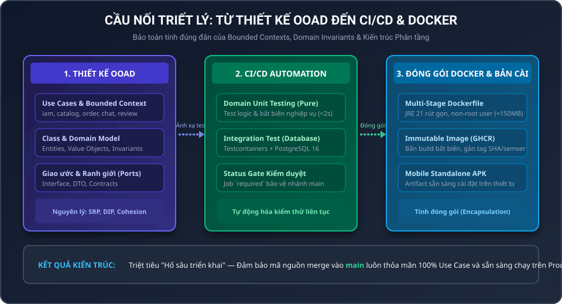
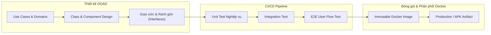
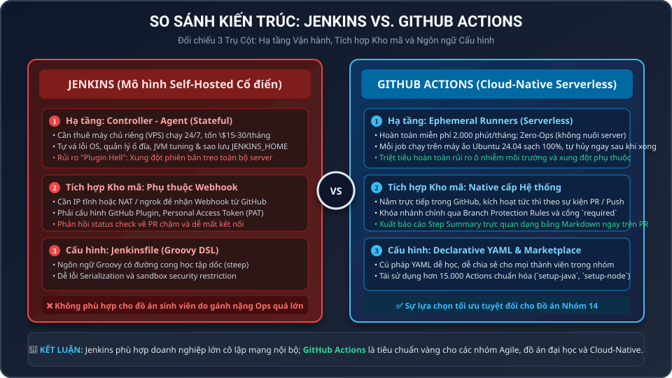
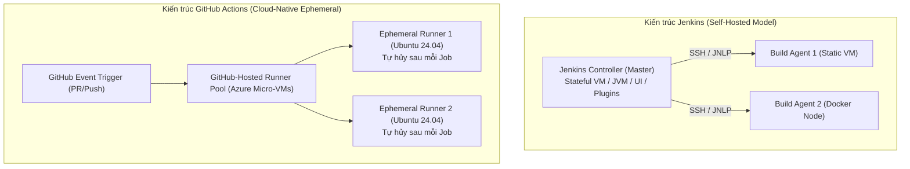
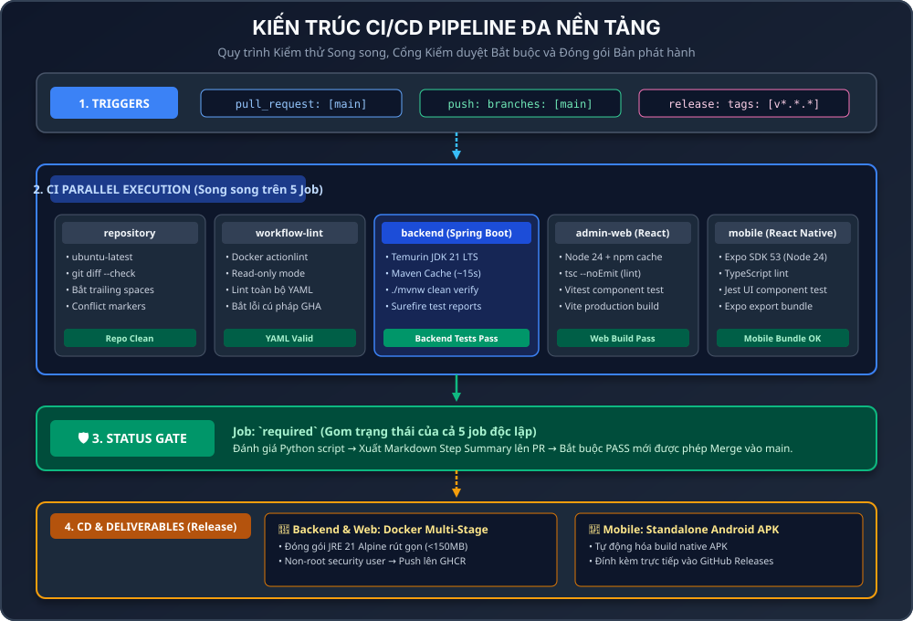
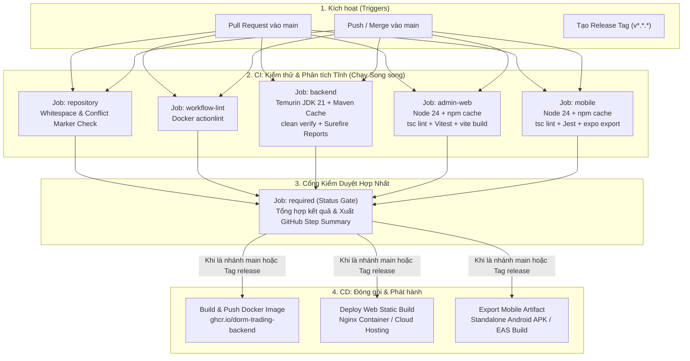
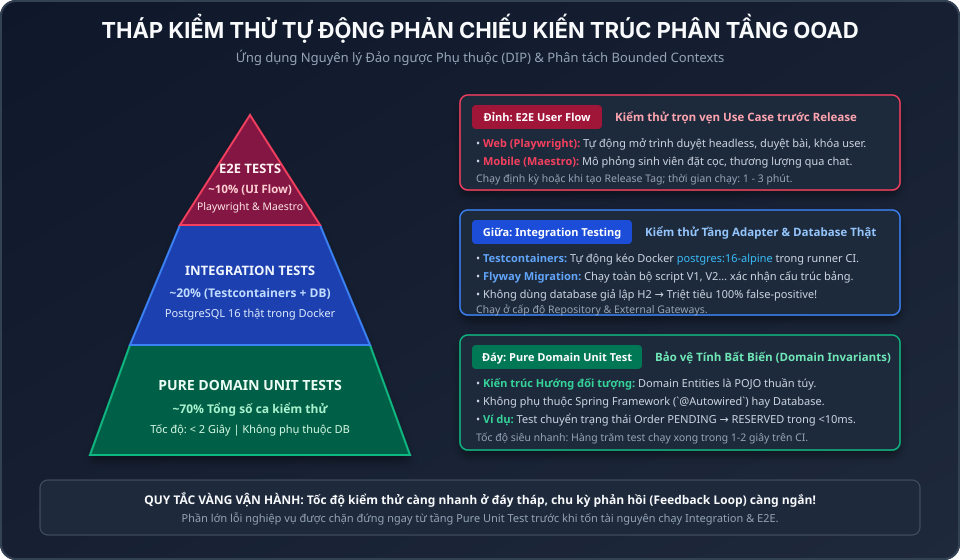

# Chuyên đề: Sử dụng CI/CD và Docker trong Triển khai Sản phẩm từ Thiết kế OOAD
## Tài liệu Kiến thức Chuyên sâu Dành cho Kỹ sư và Báo cáo Seminar

> **Tài liệu tham khảo chuyên sâu** phục vụ báo cáo seminar môn Phân tích Thiết kế Hướng đối tượng (OOAD) & Kiến trúc Phần mềm.  
> **Dự án thực chứng:** Nền tảng Trao đổi Đồ dùng Ký túc xá (*Dorm Trading Platform*).  
> **Ngăn xếp công nghệ:** Backend Java 21 / Spring Boot 3 (Modular Monolith), Web Admin React / Vite, Mobile React Native / Expo SDK 53, PostgreSQL 16, Docker, GitHub Actions.

---

## Mục lục

1. [Cầu nối Triết lý: Từ Thiết kế OOAD đến CI/CD & Docker](#1-cầu-nối-triết-lý-từ-thiết-kế-ooad-đến-cicd--docker)
   - 1.1. Nghịch lý giữa mô hình trên giấy và sản phẩm vận hành
   - 1.2. Ánh xạ nguyên lý OOAD/GRASP vào quy trình Pipeline & Đóng gói Container
2. [So sánh Chuyên sâu: Jenkins vs. GitHub Actions](#2-so-sánh-chuyên-sâu-jenkins-vs-github-actions)
   - 2.1. Kiến trúc hạ tầng và mô hình vận hành (Infrastructure & Topology)
   - 2.2. Khả năng tích hợp kho mã nguồn và sự kiện kích hoạt (Repository Integration & Triggers)
   - 2.3. Cấu hình quy trình: Groovy DSL vs. Declarative YAML
   - 2.4. Quản lý bí mật, an toàn bảo mật và OIDC
   - 2.5. Bảng tổng hợp so sánh đa tiêu chí (10 khía cạnh kỹ thuật)
3. [Lý giải Lựa chọn GitHub Actions cho Nhóm Đồ án OOAD](#3-lý-giải-lựa-chọn-github-actions-cho-nhóm-đồ-án-ooad)
   - 3.1. Phân tích chi phí sở hữu (TCO) và gánh nặng bảo trì (Zero-Ops)
   - 3.2. Đồng bộ chặt chẽ với GitHub Flow và Status Gates bảo vệ nhánh chính
   - 3.3. Hỗ trợ Monorepo và cơ chế Concurrency thông minh
4. [Thiết kế Kiến trúc CI/CD Toàn diện cho Đa nền tảng](#4-thiết-kế-kiến-trúc-cicd-toàn-diện-cho-đa-nền-tảng)
   - 4.1. Sơ đồ luồng tổng thể (Pipeline Flow Architecture)
   - 4.2. Thiết kế CI: Build và Kiểm thử song song (Backend, Admin Web, Mobile)
   - 4.3. Thiết kế CD: Đóng gói Docker Multi-stage cho API/Web và tạo bản cài Mobile
   - 4.4. Cổng kiểm duyệt chất lượng tập trung (Consolidated Quality Gate)
5. [Tích hợp Chiến lược Kiểm thử Tự động từ Thiết kế OOAD](#5-tích-hợp-chiến-lược-kiểm-thử-tự-động-từ-thiết-kế-ooad)
   - 5.1. Tháp kiểm thử phản chiếu kiến trúc phân tầng (Test Pyramid & Clean Architecture)
   - 5.2. Unit Test tầng Nghiệp vụ (Domain Invariants & Pure Unit Test)
   - 5.3. Integration Test với Testcontainers & Cơ sở dữ liệu thật
   - 5.4. E2E Web (Playwright) và E2E Mobile (Maestro) trước khi phát hành
6. [Tổng kết và Bài học Vận hành Thực tế](#6-tổng-kết-và-bài-học-vận-hành-thực-tế)

---

## 1. Cầu nối Triết lý: Từ Thiết kế OOAD đến CI/CD & Docker

### 1.1. Nghịch lý giữa mô hình trên giấy và sản phẩm vận hành

Trong quy trình công nghệ phần mềm truyền thống, sinh viên và kỹ sư thường dành hàng tuần để xây dựng mô hình Phân tích & Thiết kế Hướng đối tượng (OOAD): phân tích Ca sử dụng (Use Case), dựng Sơ đồ lớp (Class Diagram), Phân tích tương tác (Sequence Diagram) và quy hoạch Gói (Package Diagram). Tuy nhiên, khi chuyển sang bước hiện thực hóa mã nguồn và đưa lên môi trường chạy thực tế, dự án thường rơi vào **"Hố sâu ngăn cách triển khai" (Deployment Chasm)** với những vấn đề điển hình:
- *"Chạy trên máy tôi được nhưng lên máy bạn lại lỗi"* (xung đột phiên bản JDK, Node, biến môi trường, cơ sở dữ liệu).
- Mã nguồn thiết kế phân tầng rất đẹp nhưng khi code gộp (merge) liên tục bị vỡ giao ước (broken contracts), suy biến nghiệp vụ.
- Không kiểm soát được tính bất biến của bản cài đặt khi phân phối cho khách hàng/người dùng kiểm thử.

**CI/CD (Continuous Integration / Continuous Deployment)** và **Docker** chính là câu trả lời kiến trúc để khép kín vòng đời từ thiết kế đến thực thi.

<div align="center">
  
  <p><em>Hình 1: Cầu nối Kiến trúc từ Phân tích Thiết kế Hướng đối tượng đến Tự động hóa CI/CD và Đóng gói Docker</em></p>
</div>

<details>
<summary><b>📐 Xem định dạng mã nguồn sơ đồ (Mermaid Code)</b></summary>



</details>

### 1.2. Ánh xạ nguyên lý OOAD/GRASP vào quy trình Pipeline & Đóng gói Container

Một lỗi phổ biến là xem DevOps/CI/CD như một bộ phận tách rời kỹ thuật lập trình. Trên thực tế, các nguyên lý cốt lõi của OOAD phản chiếu trực tiếp lên thiết kế CI/CD và Docker:

| Nguyên lý OOAD / SOLID | Áp dụng trong Thiết kế Mã nguồn | Áp dụng trong Pipeline CI/CD & Docker |
|---|---|---|
| **Single Responsibility Principle (SRP)** | Mỗi Class/Module chỉ đảm nhận một lý do duy nhất để thay đổi. | Mỗi Job trong CI chỉ làm đúng một việc: `workflow-lint` kiểm tra cú pháp, `backend` kiểm thử Java, `admin-web` kiểm tra frontend. Mỗi Docker Container chỉ chạy một tiến trình/trách nhiệm duy nhất. |
| **High Cohesion & Low Coupling (GRASP)** | Các đối tượng trong cùng Domain gắn kết chặt chẽ; các Domain tương tác qua Interface lỏng lẻo. | **Modular Monolith**: Mã nguồn được chia theo bounded context (`iam`, `catalog`, `order`, `chat`). CI chạy unit test độc lập cho từng domain mà không cần nạp toàn bộ hạ tầng nặng nề. |
| **Dependency Inversion Principle (DIP)** | High-level module không phụ thuộc Low-level module; cả hai phụ thuộc vào Abstraction. | Core Business Logic không phụ thuộc vào Database thật hay Web Framework. Trong CI, Domain Unit Test chạy bằng POJO thuần (< 10 giây). Tầng Adapter cơ sở dữ liệu chỉ được kiểm thử ở Integration Test thông qua Testcontainers. |
| **Information Expert & Encapsulation** | Đóng gói trạng thái nội bộ, chỉ phơi bày giao diện công khai hợp lệ. | **Docker Containerization**: Container đóng gói toàn bộ hệ điều hành rút gọn, runtime (JRE/Node), thư viện phụ thuộc và cấu hình. Môi trường bên ngoài chỉ tương tác qua cổng mạng (Ports) và biến môi trường (Environment Variables). |
| **Polymorphism & Contract Testing** | Các đối tượng hiện thực hóa cùng interface có thể thay thế cho nhau. | Kiểm thử giao ước API (Contract/Schema validation): Đảm bảo Backend API và các Client (Web/Mobile) duy trì tính tương thích ngược trước khi xuất bản. |

---

## 2. So sánh Chuyên sâu: Jenkins vs. GitHub Actions

Khi xây dựng hệ thống tự động hóa kiểm thử và triển khai, hai cái tên hàng đầu luôn được đặt lên bàn cân là **Jenkins** (tượng đài tự do nguồn mở) và **GitHub Actions** (nền tảng SaaS hiện đại gắn liền hệ sinh thái GitHub).

<div align="center">
  
  <p><em>Hình 2: So sánh Đối đầu Kiến trúc Hạ tầng và Vận hành giữa Jenkins (Self-Hosted) và GitHub Actions (Cloud-Native)</em></p>
</div>

<details>
<summary><b>📐 Xem định dạng mã nguồn sơ đồ (Mermaid Code)</b></summary>



</details>

### 2.1. Kiến trúc hạ tầng và mô hình vận hành (Infrastructure & Topology)

- **Jenkins:**
  - Hoạt động theo mô hình **Controller-Agent** (Master-Worker).
  - *Controller* là một ứng dụng Java chạy liên tục (stateful), lưu trữ toàn bộ cấu hình, lịch sử build, secret và cài đặt plugin trên ổ đĩa cục bộ (`JENKINS_HOME`).
  - Đòi hỏi đội ngũ kỹ sư phải tự thiết lập máy chủ (On-Premises hoặc Cloud VM), tự cài đặt bản vá bảo mật hệ điều hành, cấu hình mạng mở port, thiết lập sao lưu dữ liệu (Backup/Disaster Recovery) và tự quản lý mở rộng các Agent.
  - Khi một bản cập nhật plugin bị xung đột thư viện (dependency hell), toàn bộ Controller có thể bị treo hoặc từ chối khởi động.

- **GitHub Actions:**
  - Hoạt động theo mô hình **Serverless / Fully Managed Runner**.
  - Mặc định sử dụng **GitHub-hosted runners**: Mỗi job được cấp phát một máy ảo hoàn toàn sạch sẽ (ephemeral micro-VM) chạy trên nền tảng Azure/AWS, được cài sẵn hàng chục công cụ chuẩn (Docker, Java, Node, Python, Android SDK).
  - Ngay sau khi job hoàn tất, máy ảo bị hủy bỏ hoàn toàn. Điều này đảm bảo tính độc lập tuyệt đối giữa các lần chạy, loại bỏ hoàn toàn rủi ro ô nhiễm môi trường (environment pollution) hay rác ổ đĩa tồn đọng.
  - Khi cần hạ tầng riêng, người dùng có thể bổ sung *Self-hosted Runner* bằng Kubernetes qua bộ điều khiển mã nguồn mở ARC (*Actions Runner Controller*).

### 2.2. Khả năng tích hợp kho mã nguồn và sự kiện kích hoạt (Repository Integration & Triggers)

- **Jenkins:**
  - Không nằm cùng hạ tầng với kho chứa mã nguồn Git. Để kết nối với GitHub/GitLab, Jenkins cần cài đặt Webhook, mở cổng Internet (hoặc dùng VPN/reverse proxy như ngrok/Cloudflare Tunnel nếu máy chủ đặt nội bộ).
  - Cần cài đặt nhiều plugin trung gian: *GitHub Plugin*, *Git Plugin*, *Pipeline Plugin*.
  - Việc phản hồi trạng thái kiểm thử (Status Checks) về giao diện Pull Request đòi hỏi cấu hình Personal Access Token (PAT) hoặc GitHub App với phân quyền phức tạp.

- **GitHub Actions:**
  - **Tích hợp tự nhiên cấp hệ thống (Native Deep Integration):** GitHub Actions là một thực thể cốt lõi bên trong GitHub.
  - Phản ứng tức thì với hơn 30 sự kiện khác nhau trong kho mã: `pull_request`, `push`, `issue_comment`, `release`, `workflow_dispatch`, `schedule` (cron).
  - Tích hợp trực tiếp vào giao diện Pull Request: hiển thị trạng thái từng step, nhật ký console thời gian thực, bảng tổng kết định dạng Markdown phong phú (*GitHub Step Summary*), và trực tiếp đóng vai trò làm điều kiện tiên quyết trong *Branch Protection Rules / Rulesets*.

### 2.3. Cấu hình quy trình: Groovy DSL vs. Declarative YAML

- **Jenkins (`Jenkinsfile`):**
  - Sử dụng ngôn ngữ **Groovy** (Declarative hoặc Scripted Pipeline).
  - *Ưu điểm:* Cực kỳ mạnh mẽ. Do là ngôn ngữ lập trình hoàn chỉnh, kỹ sư có thể viết vòng lặp, rẽ nhánh phức tạp, xử lý chuỗi và xây dựng các thư viện dùng chung (*Jenkins Shared Libraries*).
  - *Nhược điểm:* Đường cong học tập dốc (Steep Learning Curve). Yêu cầu lập trình viên phải hiểu hệ thống sandbox Groovy, xử lý lỗi `NotSerializableException`, và đối mặt với rủi ro bảo mật nếu cấp quyền thực thi mã tùy tiện trong pipeline.

- **GitHub Actions (`.github/workflows/*.yml`):**
  - Sử dụng định dạng **YAML** khai báo (Declarative syntax).
  - *Ưu điểm:* Cú pháp trực quan, dễ tiếp cận cho toàn bộ thành viên dự án. Cho phép tái sử dụng logic cực nhanh thông qua các **Action từ GitHub Marketplace** (`uses: actions/setup-java@v4`, `uses: docker/build-push-action@v5`) hoặc qua *Composite Actions* và *Reusable Workflows*.
  - *Kiểm soát chất lượng workflow:* Dễ dàng kiểm tra cú pháp tự động bằng các công cụ mã nguồn mở như `actionlint` ngay trong chính pipeline.

### 2.4. Quản lý bí mật, an toàn bảo mật và OIDC

- **Jenkins:**
  - Lưu trữ khóa bảo mật trong *Credentials Store* trên máy chủ Master. Nếu máy chủ này bị tấn công hoặc lộ bản sao lưu `credentials.xml`, toàn bộ secret của doanh nghiệp có nguy cơ bị xâm nhập.
  - Các plugin của Jenkins thường xuyên xuất hiện lỗ hổng bảo mật zero-day do cộng đồng duy trì không đồng đều.

- **GitHub Actions:**
  - Cung cấp cơ chế phân quyền tối thiểu (*Least Privilege Permissions*) ở cấp độ Workflow và Job thông qua khối `permissions: contents: read`.
  - Quản lý Secret phân cấp: Repository Secrets, Environment Secrets (gắn liền quy trình phê duyệt thủ công trước khi deploy), và Organization Secrets.
  - **Hỗ trợ OIDC (OpenID Connect):** Cho phép runner kết nối trực tiếp đến các dịch vụ đám mây (AWS, Google Cloud, Azure) thông qua cơ chế trao đổi mã thông báo ngắn hạn (short-lived federated token), loại bỏ hoàn toàn việc phải lưu trữ thông tin đăng nhập tĩnh (static credentials/API keys).

### 2.5. Bảng tổng hợp so sánh đa tiêu chí

| Tiêu chí so sánh | Jenkins | GitHub Actions |
|---|---|---|
| **Mô hình triển khai** | Tự quản lý (Self-hosted on-prem/cloud) | Đám mây có sẵn (SaaS Managed) + Tuỳ chọn Self-hosted |
| **Chi phí hạ tầng ban đầu** | Tốn kém: Cần máy chủ chuyên dụng, IP tĩnh, lưu trữ | Bằng 0: 2,000 phút miễn phí/tháng cho tài khoản cá nhân, không giới hạn cho repo công khai |
| **Bảo trì & Vận hành (Ops Overhead)** | Rất cao: Nâng cấp phiên bản, bảo trì máy ảo, vá lỗi bảo mật, quản lý xung đột plugin | Gần như bằng 0 (Zero-Ops): Hạ tầng do GitHub đảm bảo độ sẵn sàng cao 99.9% |
| **Môi trường chạy (Runners)** | Máy chủ tĩnh hoặc cụm container tự cấu hình | Máy ảo tạm thời (Ephemeral VMs) khởi tạo và giải phóng tự động sau mỗi lần chạy |
| **Ngôn ngữ định nghĩa** | Groovy DSL (Declarative / Scripted) | YAML chuẩn hóa kết hợp biểu thức GitHub Expression |
| **Kho tiện ích mở rộng** | ~1,800 Jenkins Plugins (chất lượng và bảo trì không đồng đều) | 15,000+ Actions trên GitHub Marketplace được bảo chứng bởi các tổ chức uy tín |
| **Tích hợp kho mã (VCS)** | Đa nền tảng (GitHub, GitLab, Bitbucket, SVN) qua Webhook | Tích hợp gốc và sâu nhất với hệ sinh thái GitHub |
| **Cơ chế Cache** | Phụ thuộc vào ổ cứng dùng chung của Agent hoặc plugin bên thứ 3 | Tích hợp sẵn Action cache phân tán (`actions/cache`) tốc độ cao |
| **Bảo vệ mã nguồn & Quy trình PR** | Khó thiết lập trạng thái bắt buộc, cần token đồng bộ | Kết nối trực tiếp vào Branch Protection Rule & Rulesets chỉ với 1 cú click |
| **Phù hợp nhất cho** | Doanh nghiệp lớn với hạ tầng nội bộ cô lập (Air-gapped) hoặc hệ thống kế thừa phức tạp | Các nhóm dự án hiện đại, Agile/DevOps, Cloud-native và Đồ án sinh viên |

---

## 3. Lý giải Lựa chọn GitHub Actions cho Nhóm Đồ án OOAD

Đối với dự án đồ án môn học như **Dorm Trading Platform** (nhóm 5-6 thành viên, thời gian phát triển ngắn, ngân sách 0 đồng, yêu cầu chất lượng cao), việc lựa chọn GitHub Actions là một **quyết định kỹ thuật tối ưu mang tính chiến lược** dựa trên 4 trụ cột:

### 3.1. Phân tích chi phí sở hữu (TCO) và gánh nặng bảo trì (Zero-Ops)
- Nếu chọn Jenkins, nhóm bắt buộc phải thuê một máy chủ ảo (VPS) có ít nhất 4GB RAM (đủ chạy Jenkins Controller và Java compiler), chi phí dao động từ \$10 - \$20/tháng, hoặc phải tận dụng máy tính cá nhân làm server. Máy tính cá nhân sẽ gặp rủi ro mất mạng, tắt nguồn hoặc thiếu IP tĩnh để nhận webhook từ GitHub.
- Ngược lại, **GitHub Actions hoàn toàn miễn phí**: 2,000 phút chạy mỗi tháng cho repo riêng tư và không giới hạn phút chạy cho repo công khai. Nhóm đạt được trạng thái **Zero-Ops**: không tốn một phút nào bảo trì máy chủ, tập trung 100% thời gian vào việc hoàn thiện thiết kế OOAD và viết mã nghiệp vụ.

### 3.2. Đồng bộ chặt chẽ với GitHub Flow và Status Gates bảo vệ nhánh chính
- Trong mô hình phát triển phân tán của đồ án, rủi ro lớn nhất là thành viên merge mã lỗi trực tiếp vào nhánh `main`.
- GitHub Actions cho phép thiết lập cổng kiểm duyệt chất lượng tập trung (ví dụ job `required`). Khi kết hợp với **Branch Protection Rules / Rulesets**:
  - Không một ai (kể cả nhóm trưởng) có thể merge mã nếu chưa vượt qua toàn bộ test và kiểm tra cú pháp.
  - Bắt buộc phải có ít nhất 1 thành viên review và phê duyệt (Code Review Approval).
  - Tự động đóng gói báo cáo kết quả kiểm thử Surefire và Step Summary trực quan ngay dưới từng Pull Request.

### 3.3. Hỗ trợ Monorepo và cơ chế Concurrency thông minh
- Dự án `dorm-trading-platform` áp dụng mô hình Monorepo (chứa cả `backend/`, `admin-web/`, `mobile/`, `docs/`).
- GitHub Actions cung cấp tính năng `concurrency`:
  ```yaml
  concurrency:
    group: ci-${{ github.workflow }}-${{ github.event.pull_request.number || github.ref }}
    cancel-in-progress: ${{ github.event_name == 'pull_request' }}
  ```
  Khi một lập trình viên liên tục commit vào PR để sửa lỗi, Actions sẽ **tự động hủy bỏ các lượt chạy cũ đang dở dang** để dồn tài nguyên cho commit mới nhất. Điều này tiết kiệm tối đa thời gian chờ đợi và hạn chế lãng phí quota tính toán.

### 3.4. Hệ sinh thái hoàn chỉnh và tính sẵn sàng cho phát triển bền vững
- Khi cần bổ sung chức năng kiểm thử tĩnh, nhóm chỉ mất 5 phút để tích hợp Docker `rhysd/actionlint` kiểm tra cú pháp workflow, hay cấu hình `actions/setup-java` để tự động kích hoạt bộ nhớ đệm Maven (`cache: 'maven'`).
- Tốc độ chạy CI nhờ cache chỉ mất **khoảng 10 - 15 giây** cho các commit tiếp theo, tạo phản hồi gần như tức thì cho lập trình viên (Fast Feedback Loop).

---

## 4. Thiết kế Kiến trúc CI/CD Toàn diện cho Đa nền tảng

Dự án bao gồm 3 phân hệ chính tương tác qua kiến trúc hướng dịch vụ:
1. **Backend API:** Spring Boot 3.5.14, Java 21, Maven Wrapper, PostgreSQL 16.
2. **Admin Web:** React 18, Vite 6, TypeScript, Vitest.
3. **Mobile Client:** React Native, Expo SDK 53, TypeScript, Jest.

### 4.1. Sơ đồ luồng tổng thể (Pipeline Flow Architecture)

<div align="center">
  
  <p><em>Hình 3: Thiết kế Luồng Pipeline CI/CD Song song, Cổng Kiểm duyệt Bắt buộc và Đóng gói Bản phát hành</em></p>
</div>

<details>
<summary><b>📐 Xem định dạng mã nguồn sơ đồ (Mermaid Code)</b></summary>



</details>

### 4.2. Thiết kế CI: Build và Kiểm thử song song

Pipeline CI được tổ chức trong `.github/workflows/ci.yml`. Để tối ưu hóa thời gian thực thi (Execution Time), tất cả các job độc lập được kích hoạt chạy hoàn toàn song song:

#### a) Kiểm soát chất lượng kho lưu trữ (`repository` & `workflow-lint`)
- `repository`: Kiểm tra lỗi khoảng trắng dư thừa (*trailing whitespace*) và dấu vết xung đột mã nguồn (*conflict markers* như `<<<<<<< HEAD`) trên toàn bộ dải commit bằng lệnh `git diff --check`.
- `workflow-lint`: Tận dụng container Docker `rhysd/actionlint:1.7.12` ở chế độ read-only để bắt lỗi cú pháp YAML và sai lệch biến môi trường của Actions trước khi chúng có cơ hội thực thi.

#### b) Phân hệ Backend (`backend`)
- Sử dụng runner `ubuntu-latest` cài đặt **Eclipse Temurin JDK 21 LTS**.
- Bật cơ chế đệm phụ thuộc tự động: `cache: 'maven'`.
- Thực thi kiểm thử và đóng gói không tải thông báo tiến trình thừa:
  ```bash
  ./mvnw --batch-mode --no-transfer-progress clean verify
  ```
- Tự động thu thập kết quả kiểm thử JUnit/Surefire dưới dạng artifact (`actions/upload-artifact@v4`) ngay cả khi có ca kiểm thử thất bại (`if: always()`).

#### c) Phân hệ Admin Web (`admin-web`)
- Sử dụng môi trường **Node 24 LTS** với `cache: npm` trỏ đúng vào `admin-web/package-lock.json`.
- Cài đặt nguyên vẹn bản phụ thuộc từ lockfile: `npm ci`.
- Kiểm tra kiểu dữ liệu tĩnh nghiêm ngặt: `npm run lint` (thực thi `tsc --noEmit`).
- Chạy toàn bộ Unit/Component tests bằng Vitest: `npm test`.
- Kiểm tra tính hợp lệ của quá trình đóng gói production: `npm run build`.

#### d) Phân hệ Mobile (`mobile`)
- Sử dụng Node 24 LTS, Expo SDK 53, `CI: 'true'`.
- Kiểm tra tính tương thích TypeScript cho React Native: `npm run lint`.
- Chạy Unit test các component giao diện và hook logic bằng Jest: `npm test`.
- Thử nghiệm đóng gói bundle ứng dụng di động: `npx expo export --platform android`.

### 4.3. Thiết kế CD: Đóng gói Docker Multi-stage cho API/Web và tạo bản cài Mobile

Khi mã nguồn được merge vào `main` hoặc khi gắn tag phiên bản (`v1.0.0`), quy trình CD được kích hoạt để tạo ra các **bản phân phối bất biến (Immutable Deliverables)**:

#### a) Backend API - Đóng gói Docker Multi-stage tối ưu
Việc đóng gói Spring Boot yêu cầu đảm bảo hai yếu tố: kích thước ảnh nhỏ gọn và bảo mật tuyệt đối khi chạy trong môi trường container.

```dockerfile
# ---------------------------------------------------------------------
# STAGE 1: Build stage với đầy đủ JDK và Maven Wrapper
# ---------------------------------------------------------------------
FROM eclipse-temurin:21-jdk-alpine AS builder
WORKDIR /workspace

# Tận dụng Docker layer cache cho dependencies
COPY .mvn/ .mvn/
COPY mvnw pom.xml ./
RUN ./mvnw dependency:go-offline --batch-mode

# Sao chép mã nguồn và biên dịch thành JAR tối ưu
COPY src/ src/
RUN ./mvnw clean package -DskipTests --batch-mode

# Trích xuất Spring Boot Layered JAR để tối ưu hóa cache khi deploy
RUN java -Djarmode=layertools -jar target/*.jar extract --destination target/extracted

# ---------------------------------------------------------------------
# STAGE 2: Runtime stage siêu nhẹ với JRE rút gọn, Non-root User
# ---------------------------------------------------------------------
FROM eclipse-temurin:21-jre-alpine AS runner
WORKDIR /app

# Tạo user không có đặc quyền root để tuân thủ tiêu chuẩn an toàn thông tin
RUN addgroup -S appgroup && adduser -S appuser -G appgroup

# Sao chép các layer từ build stage
COPY --from=builder --chown=appuser:appgroup /workspace/target/extracted/dependencies/ ./
COPY --from=builder --chown=appuser:appgroup /workspace/target/extracted/spring-boot-loader/ ./
COPY --from=builder --chown=appuser:appgroup /workspace/target/extracted/snapshot-dependencies/ ./
COPY --from=builder --chown=appuser:appgroup /workspace/target/extracted/application/ ./

USER appuser
EXPOSE 8082

ENTRYPOINT ["java", "org.springframework.boot.loader.launch.JarLauncher"]
```

#### b) Admin Web - Nginx Alpine Static Serving
Frontend React được biên dịch thành các tệp tĩnh (HTML/CSS/JS) và phân phối qua Nginx unprivileged:
- Build stage: `node:24-alpine` chạy `npm run build`.
- Serve stage: `nginxinc/nginx-unprivileged:alpine`, sao chép thư mục `dist/` vào `/usr/share/nginx/html`, định tuyến mọi đường dẫn về `index.html` (Single Page Application routing).

#### c) Mobile - Tự động tạo bản cài Android APK
Đối với ứng dụng di động, quy trình CD tự động hóa việc xuất bản file cài đặt `.apk` để các thành viên hoặc giảng viên có thể quét mã QR cài đặt trực tiếp trên điện thoại mà không cần môi trường lập trình:
- **Cách 1: Sử dụng EAS Build (Expo Application Services):**
  - Chạy `eas build -p android --profile preview --non-interactive`.
  - Sinh đường dẫn tải file APK trực tiếp từ đám mây của Expo.
- **Cách 2: Build Native Standalone APK qua GitHub Actions Runner:**
  - Khởi tạo môi trường `actions/setup-java@v4` (JDK 17) và `android-actions/setup-android@v3`.
  - Chạy lệnh `npx expo prebuild` và `./android/gradlew assembleRelease`.
  - Đính kèm file `app-release.apk` vào **GitHub Releases** thông qua `actions/upload-release-asset`.

### 4.4. Cổng kiểm duyệt chất lượng tập trung (Consolidated Quality Gate)

Thay vì yêu cầu Branch Protection phải theo dõi 5 check riêng lẻ (khiến việc sửa tên job trong tương lai làm gãy quy tắc nhánh), pipeline sử dụng pattern **Status Gate Aggregation**:

```yaml
  required:
    name: required
    runs-on: ubuntu-latest
    needs: [repository, workflow-lint, backend, admin-web, mobile]
    if: ${{ always() }}
    timeout-minutes: 5
    steps:
      - name: Evaluate mandatory CI checks
        env:
          RESULTS: ${{ toJSON(needs) }}
        shell: bash
        run: |
          python3 - <<'PY'
          import json, os, sys
          results = json.loads(os.environ.get('RESULTS', '{}'))
          failures = {job: data.get('result') for job, data in results.items() 
                      if data.get('result') != 'success'}
          
          summary_file = os.environ.get('GITHUB_STEP_SUMMARY')
          if summary_file:
              with open(summary_file, 'a', encoding='utf-8') as f:
                  f.write("### 🛡️ Cổng Kiểm Duyệt Chất Lượng CI (Mandatory Status Gate)\n\n")
                  f.write("| Thành phần kiểm tra | Kết quả | Trạng thái |\n")
                  f.write("| --- | --- | :---: |\n")
                  for job, data in results.items():
                      res = data.get('result', 'unknown')
                      badge = "✅ PASS" if res == 'success' else "❌ FAIL"
                      f.write(f"| `{job}` | `{res}` | {badge} |\n")
          
          if failures:
              print(f"Lỗi: Các job bắt buộc không vượt qua: {failures}", file=sys.stderr)
              sys.exit(1)
          print("Tất cả các job kiểm tra đều đạt yêu cầu!")
          PY
```

---

## 5. Tích hợp Chiến lược Kiểm thử Tự động từ Thiết kế OOAD

### 5.1. Tháp kiểm thử phản chiếu kiến trúc phân tầng (Test Pyramid)

<div align="center">
  
  <p><em>Hình 4: Tháp Kiểm thử Tự động (Test Pyramid) Phản chiếu Kiến trúc Phân tầng và Nguyên lý Đảo ngược Phụ thuộc (DIP)</em></p>
</div>

<details>
<summary><b>📐 Xem mô hình dạng ký tự ASCII</b></summary>

```
             / \
            /   \       E2E Tests (Playwright / Maestro)
           / E2E \      -> 10% - Kiểm thử luồng nghiệp vụ xuyên suốt Client - Server
          /-------\
         / Integr- \    Integration Tests (Testcontainers + PostgreSQL)
        /   ation   \   -> 20% - Kiểm thử Adapter, Repository, Database Migrations
       /-------------\
      /   Domain      \ Pure Unit Tests (JUnit 5, Mockito, Vitest, Jest)
     /  Unit Testing   \ -> 70% - Kiểm thử Bất biến Nghiệp vụ, State Machines, Entities
    /-------------------\
```

</details>

### 5.2. Unit Test tầng Nghiệp vụ (Domain Invariants & Pure Unit Test)

Trong thiết kế hướng đối tượng, **Tầng Miền (Domain Layer)** chứa các thực thể (Entities), Giá trị đối tượng (Value Objects) và Quy tắc nghiệp vụ cốt lõi (Business Invariants). 
- Các lớp này phải **hoàn toàn độc lập** với framework (không phụ thuộc `@Autowired`, không phụ thuộc cơ sở dữ liệu).
- **Ví dụ nghiệp vụ dự án Dorm Trading:**
  - *Quy tắc giữ chỗ đơn hàng (`order` module):* Khi người mua yêu cầu đặt cọc món đồ, trạng thái đơn hàng chỉ được phép chuyển từ `PENDING` sang `RESERVED` nếu món đồ đó chưa bị ai giữ chỗ và thời hạn sinh viên chưa hết hạn.
  - *Đặc điểm kỹ thuật:* Bộ test viết bằng **JUnit 5 thuần** hoặc dùng Mockito giả lập cổng phụ thuộc (ports/gateways).
  - *Thời gian thực thi:* Hàng trăm ca kiểm thử chỉ mất **dưới 2 giây**, cho phép lập trình viên chạy lặp lại liên tục (TDD - Test Driven Development) trước cả khi commit.

### 5.3. Integration Test với Testcontainers & Cơ sở dữ liệu thật

Nhiều dự án mắc sai lầm nghiêm trọng khi sử dụng cơ sở dữ liệu trong bộ nhớ H2 để test ứng dụng chạy PostgreSQL thật trên production. H2 không hỗ trợ các kiểu dữ liệu đặc thù của Postgres (JSONB, UUID, Full-text Search, các ràng buộc ngoại khóa phức tạp).

Giải pháp hiện đại chuẩn công nghiệp được nhóm tích hợp là **Testcontainers**:
- Khi job `backend` chạy trong runner GitHub Actions, thư viện Testcontainers sẽ tự động gọi Docker Daemon cục bộ để kéo image `postgres:16-alpine`.
- Khởi động một container PostgreSQL hoàn toàn biệt lập trên cổng ngẫu nhiên.
- Flyway tự động chạy các script migration (`V1__init_schema.sql`, `V2__seed_categories.sql`).
- Thực thi các bài test tầng Repository / Persistence để xác nhận truy vấn SQL và ánh xạ JPA chính xác 100% với môi trường production thực tế.

```java
@Testcontainers
@SpringBootTest(webEnvironment = SpringBootTest.WebEnvironment.RANDOM_PORT)
class OrderRepositoryIntegrationTest {

    @Container
    static PostgreSQLContainer<?> postgres = new PostgreSQLContainer<>("postgres:16-alpine")
            .withDatabaseName("dorm_trading_test")
            .withUsername("test")
            .withPassword("test");

    @DynamicPropertySource
    static void configureProperties(DynamicPropertyRegistry registry) {
        registry.add("spring.datasource.url", postgres::getJdbcUrl);
        registry.add("spring.datasource.username", postgres::getUsername);
        registry.add("spring.datasource.password", postgres::getPassword);
    }

    @Test
    void shouldPersistOrderAndEnforceUniqueReservationConstraint() {
        // Thực thi kiểm thử giao dịch thật trên PostgreSQL container
    }
}
```

### 5.4. E2E Web (Playwright) và E2E Mobile (Maestro) trước khi phát hành

Kiểm thử đầu-cuối (End-to-End Testing) là bước phòng thủ cuối cùng trước khi đóng gói sản phẩm phát hành, mô phỏng đúng hành vi người dùng thật trên giao diện:

- **E2E Web Quản trị với Playwright:**
  - Chạy ở chế độ Headless Browser (Chromium/Firefox) trực tiếp trong GitHub Actions runner.
  - Tự động dựng môi trường giả lập (hoặc khởi động backend test container), mở giao diện Web Admin, đăng nhập bằng tài khoản quản trị viên, duyệt bài đăng đồ dùng của sinh viên và kiểm tra xem danh sách bài chờ duyệt có biến mất đúng như thiết kế UC hay không.
  - Tự động chụp ảnh màn hình (*screenshot*) và ghi video trace khi có ca kiểm thử thất bại.

- **E2E Mobile với Maestro:**
  - Maestro là framework kiểm thử tự động hóa di động hiện đại nhất hiện nay (vượt trội hơn Appium về độ ổn định và tốc độ viết test bằng cú pháp YAML).
  - Kịch bản mô phỏng sinh viên mở app, tìm kiếm "Nồi cơm điện", bấm chọn tin và gửi tin nhắn thương lượng.
  - Trong CI, kịch bản E2E Mobile được kích hoạt định kỳ hoặc trước khi merge PR lớn thông qua Android Emulator chạy headless hoặc dịch vụ đám mây AWS Device Farm.

---

## 6. Tổng kết và Bài học Vận hành Thực tế

1. **Kiến trúc quyết định Pipeline:** Thiết kế hướng đối tượng tốt (Loose Coupling, High Cohesion, Clean Architecture) là điều kiện tiên quyết để xây dựng một pipeline CI/CD nhanh, ổn định và dễ bảo trì. Nếu mã nguồn là một khối spaghetti dính chặt vào database, pipeline sẽ cực kỳ chậm chạp và thường xuyên bị false-positive.
2. **GitHub Actions là sự lựa chọn tối ưu cho nhóm tinh gọn:** Loại bỏ hoàn toàn chi phí vận hành máy chủ, mang lại khả năng kiểm soát chất lượng tự động hóa cấp cao nhất thông qua quy trình PR và Branch Protection Rules.
3. **Docker là tiêu chuẩn vàng của tính bất biến (Immutability):** Đóng gói đa tầng (Multi-stage build) bảo vệ ứng dụng khỏi các lỗ hổng bảo mật runtime, giảm dung lượng container từ hàng gigabyte xuống dưới 150MB và đảm bảo tính nhất quán tuyệt đối giữa môi trường phát triển cục bộ và môi trường phát hành.
4. **Cổng kiểm duyệt hợp nhất bảo vệ sản phẩm:** Cấu hình một cổng kiểm duyệt duy nhất (`required`) giúp nhóm đồ án duy trì kỷ luật kỹ thuật, đảm bảo không một dòng code lỗi nào có thể lọt vào nhánh sản phẩm chính thức.

---
*Tài liệu được biên soạn và bảo chứng bởi Nhóm 14 - Đồ án OOAD & Kiến trúc Phần mềm.*

